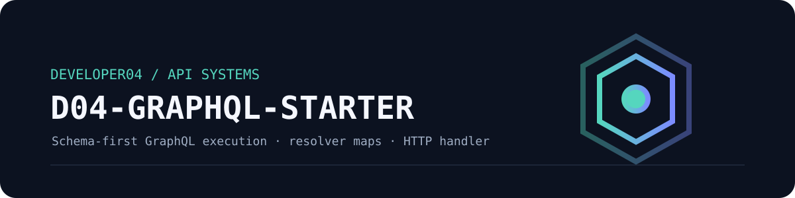

<p align="center"></p>

# d04-graphql-starter

A schema-first GraphQL service factory for Node.js, built on the official graphql-js execution engine.

## Features
- Node.js 20+ ES modules
- Small, explicit API surface
- Async handler support and predictable HTTP responses
- No framework lock-in
- Animated SVG project banner

## Install
```bash
npm install
```

## Quick start
```js
import { createGraphQLService } from "d04-graphql-starter";
const service = createGraphQLService({
  typeDefs: "type Query { hello(name: String!): String! }",
  resolvers: { hello: ({ name }) => "Hello, " + name }
});
const result = await service.execute('{ hello(name: "Developer04") }');
console.log(result.data);
```

## Development
```bash
npm test
```

## Design notes
The package validates the schema at construction time, delegates parsing and execution to graphql-js, and exposes an HTTP handler for POST requests. Add authentication, query depth limits, rate limits, and production logging at the application boundary.

## License
MIT
